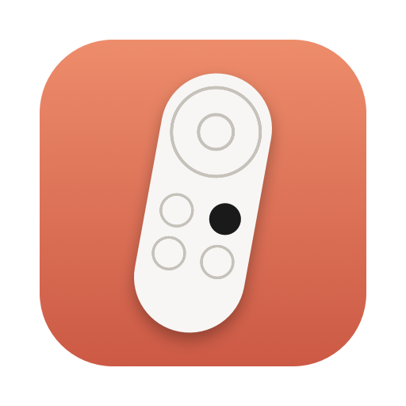
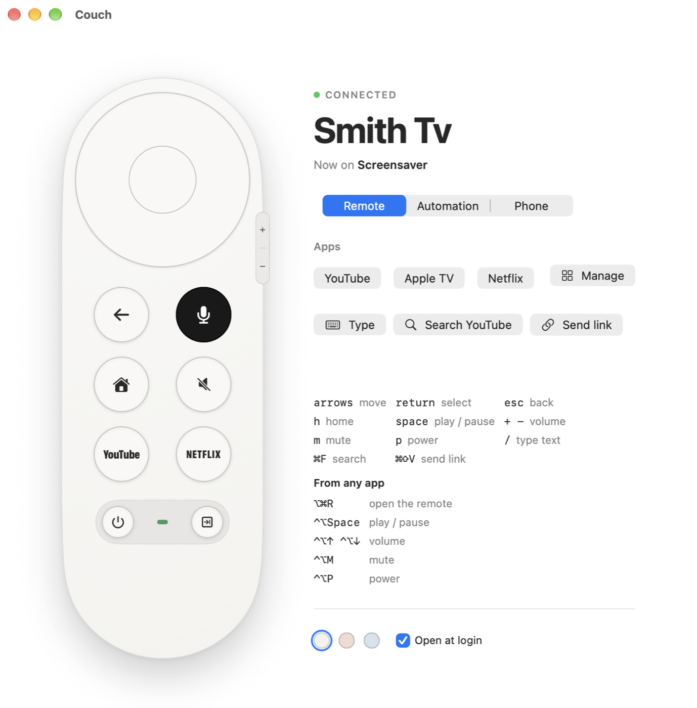
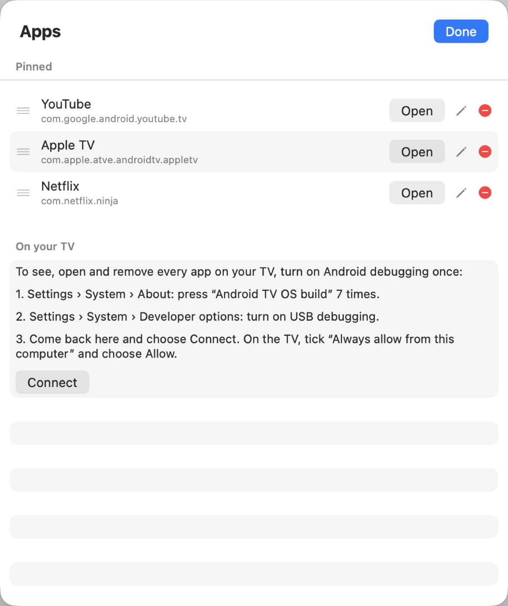
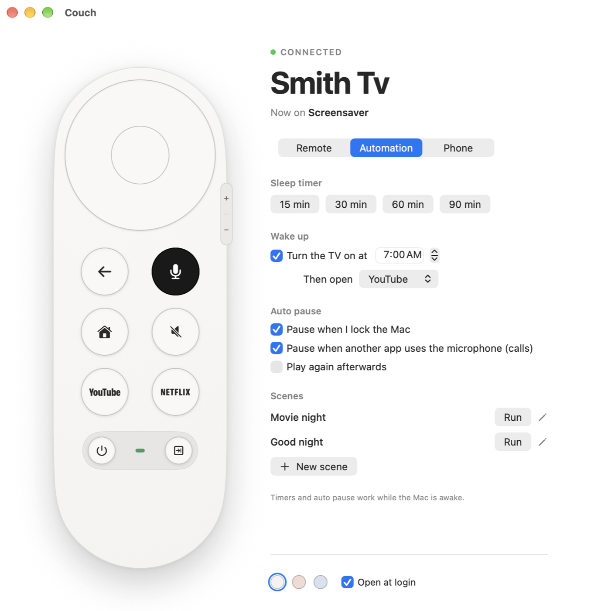

<p align="center">
  
</p>

<h1 align="center">Couch</h1>

<p align="center">
  A native Mac remote for Chromecast with Google TV.<br>
  Menu bar, keyboard, trackpad, voice, phone and automations, all over your home Wi-Fi.
</p>

<p align="center">
  
</p>

## Why

The remote that ships with the Chromecast is easy to lose and hard to type with. Couch turns the Mac you already have open into a better one. It speaks the same protocol as Google's own remote app, so nothing is installed on the TV and nothing leaves your network.

## Features

**Remote**
- A faithful remote: direction pad, back, home, mute, YouTube, Netflix, power, input and a side volume rocker, in Snow, Sunrise or Sky.
- Lives in the menu bar and as a window. Opens from anywhere with <kbd>⌥</kbd><kbd>⌘</kbd><kbd>R</kbd>, and starts at login if you want it to.
- Your keyboard is the remote: arrows, Return, Esc, Space and a few letters. Two finger swipes on the trackpad move around the TV.
- Global shortcuts for play, pause, volume, mute and power that work while any app is in front, with an on screen volume sign.

**Typing and voice**
- Typing mode sends your keystrokes straight into the text box on the TV, with delete, cursor keys, paste (<kbd>⌘</kbd><kbd>V</kbd>) and clear. Couch shows what the TV box says as you type.
- Hold the mic button and speak to search, like the Assistant button on the real remote.
- Search YouTube from the Mac, or drop any link on the window or menu bar icon to play it on the TV.

**Apps**
- Pin your apps for one click launch, reorder them and remove them.
- With Android debugging turned on, see every installed app, open any of them and uninstall the ones you added.

<p align="center">
  
</p>

**Recent apps and TV upgrades** (with Android debugging on)
- A Recent strip of the apps open on the TV. Click one to bring it back exactly where you left it; close the ones you are done with.
- One click to the TV's Settings.
- Install Android apps from the Mac: drop an `.apk` on Couch.
- Space and memory at a glance, with Free Up Space (clears app caches) and Free Memory (stops background apps).
- Faster animations, screensaver and sleep timing, each with Reset to the TV's own settings.
- Switch to an ad free home screen (Projectivy) and back to Google TV at any time.
- Once paired, Couch follows the TV's debugging connection across restarts by itself.

**Automation**
- Sleep timer and a daily wake up time that can open an app.
- Pauses the TV when you join a call, and can resume afterwards. Pausing when you lock the Mac is there too, off unless you turn it on.
- Scenes: one click runs a list of steps, like "Movie night" (TV on, wait, open Netflix).
- `couch://` links for Shortcuts and scripts, with a confirmation before anything reaches the TV.

<p align="center">
  
</p>

**Phone**
- The same remote on any phone on your Wi-Fi. Scan a QR code from the Mac, then add it to the home screen.

## How it works

```
 Couch.app (SwiftUI + AppKit)                    Chromecast with Google TV
 ├─ window, menu bar panel, shortcuts            ┌─────────────────────────┐
 ├─ voice capture (8 kHz PCM)                    │  Android TV Remote v2   │
 └─ WebSocket, 127.0.0.1 only ──┐                │  (TLS, client cert)     │
                                ▼                │                         │
 Helper (Python, asyncio) ──────────────────────▶│  ADB, optional          │
 ├─ androidtvremote2: keys, text, voice, links   └─────────────────────────┘
 ├─ Google's adb: installed apps (opt in)
 └─ phone page server, LAN, token gated ◀── phone browser
```

The Mac app draws everything natively and talks to a small helper process it starts and stops itself. The helper holds the TV connection: [androidtvremote2](https://github.com/tronikos/androidtvremote2) for the remote protocol, and Google's `adb` tool (with Wireless debugging pairing) for the optional app manager. The TV is found over Bonjour with [zeroconf](https://github.com/python-zeroconf/python-zeroconf).

Two things Couch fixes on top of the library, both found against a real Chromecast with Google TV 4K and covered by tests in `tests/`:
- Typed text is only accepted when it carries the TV's app counter and the focused field id, not the counters the library sends.
- Each edit must name the cursor position after it, counted over the whole field in UTF-16 units, or the TV cuts the text off.

## Requirements

- macOS 15 or later on Apple Silicon
- Xcode command line tools (`xcode-select --install`)
- [uv](https://docs.astral.sh/uv/) for the Python helper
- For the app manager only: Google's adb (`brew install --cask android-platform-tools`)
- A Chromecast with Google TV (or another Google TV / Android TV device) on the same network

## Build and run

```sh
git clone https://github.com/abiodunosagie/couch.git
cd couch
./build-app.sh
open ~/Applications/Couch.app
```

`build-app.sh` checks that the helper starts, compiles the app, draws the icon and installs `Couch.app` into `~/Applications`. The app runs the helper from the cloned folder, so rebuild after moving it.

## First run

1. Couch finds the TV on your network and asks for the 6 character code the TV shows. That pairs this Mac once.
2. For the full app list (optional): on the TV open **Settings › System › About** and press **Android TV OS build** seven times. In **Developer options** turn on **USB debugging** and **Wireless debugging**. Open **Wireless debugging › Pair device with pairing code**, then in Couch choose **Apps › Manage** and type the 6 digit code.
3. For the phone remote (optional): open the **Phone** tab, turn it on and scan the code.

## Keyboard

| In Couch | | From any app | |
| --- | --- | --- | --- |
| Arrows | Move | <kbd>⌥</kbd><kbd>⌘</kbd><kbd>R</kbd> | Open the remote |
| Return | Select | <kbd>⌃</kbd><kbd>⌥</kbd><kbd>Space</kbd> | Play or pause |
| Esc | Back | <kbd>⌃</kbd><kbd>⌥</kbd><kbd>↑</kbd> / <kbd>↓</kbd> | Volume |
| H / Space / M / P | Home / Play / Mute / Power | <kbd>⌃</kbd><kbd>⌥</kbd><kbd>M</kbd> | Mute |
| `/` | Type on the TV | <kbd>⌃</kbd><kbd>⌥</kbd><kbd>P</kbd> | Power |
| <kbd>⌘</kbd><kbd>F</kbd> | Search YouTube | | |
| <kbd>⌘</kbd><kbd>⇧</kbd><kbd>V</kbd> | Play the copied link | | |

## Privacy and security

- The helper listens on `127.0.0.1` only and every request carries a random token made at launch, so other apps and websites cannot drive the TV.
- The phone page is off by default. When on, it needs a pairing token from the QR code and checks Host and Origin. Phones can use the remote, type, search YouTube, reopen apps from the Recent strip and open Settings. They never receive the text of the TV's text box or when each app was last used, and cannot pair, use voice, open links, install or uninstall apps, or change TV settings. Turning it off or choosing "Forget Paired Phones" disconnects phones at once.
- The phone page uses plain HTTP on your home network, so the pairing token is only as private as your Wi-Fi.
- Keys and certificates live in `~/.config/tvremote`, readable only by you. Typed text and voice are never written to disk or logs.
- The app manager runs only fixed commands with strictly checked, quoted arguments, only uninstalls apps you installed, and only changes the three TV settings it lists, always saving the TV's own value first.
- Call detection reads whether another app is using the microphone. It records nothing.

## Command line

The helper doubles as a small CLI:

```sh
uv run python tvremote.py status
uv run python tvremote.py key HOME
uv run python tvremote.py text "breaking bad"
uv run python tvremote.py open https://www.youtube.com
```

## Development

```sh
uv sync
uv run pytest
./build-app.sh
```

```
mac/            SwiftUI and AppKit app
server.py       helper: WebSocket API and TV session
handlers_apps.py requests that use the app manager, run off the socket loop
text_input.py   typing into TV text boxes
apps.py         installed and recent apps over ADB
tv_tools.py     installing, TV settings, space, memory, home screen
phone.py        phone page server
phone/          phone page (HTML, CSS, JS)
tv.py           discovery, pairing, shared app table
known_apps.json app names and launch links, shared by every part
```

## Limitations

- Timers and auto pause run while the Mac is awake.
- The TV reports no volume level through this protocol, so the volume sign shows direction only.
- Copying text off the TV is not possible.
- Voice on the phone page needs HTTPS, so it stays on the Mac for now.

## License

[MIT](LICENSE)
